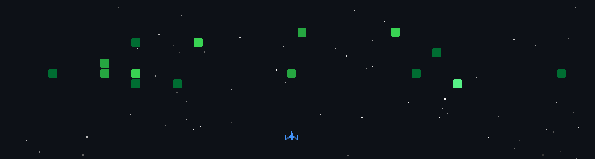

<p align="center">
  
</p>

<p align="center">
  <a href="https://github.com/StoneTone">
    
  </a>
</p>

<p align="center">
  <a href="https://santosantonio.com" target="_blank"></a>&nbsp;
  <a href="https://www.linkedin.com/in/antoniojosephsantos/" target="_blank"></a>&nbsp;
  <a href="https://github.com/StoneTone?tab=followers"></a>&nbsp;
  &nbsp;
  
</p>

---

## 👨‍🚀 Mission Briefing

```yaml
callsign:   Antonio
role:       Full Stack Developer
base:       Earth (for now)
primary:    [Java, Spring Boot, React]
secondary:  [Python, JavaScript, C#, SQL]
specialty:  Microservices, REST APIs, automation, self-hosted everything
objective:  Build things that are useful, fast, and run on my own hardware
```

---

## 🛰️ Flight Systems

<p align="center">
  
  
  
  
  
  
  
</p>
<p align="center">
  
  
  
  
  
  
</p>

---

## 🚀 Mission Log

<table>
<tr>
<td width="50%" valign="top">

### 🎵 [Discord Bot V3](https://github.com/StoneTone/DiscordBotV3)
A multi-purpose Discord bot: music from YouTube (live streams and playlists), SoundCloud, and lofi radio, plus a `/gpt` command, Twitch go-live alerts, CS2 case-opening simulation, and server utilities.

**Stack:** Java · Spring Boot · JDA · Lavaplayer · Docker
**Launch system:** GitHub Actions CI/CD with automatic deploys

[](https://github.com/StoneTone/DiscordBotV3)


</td>
<td width="50%" valign="top">

### 🤝 [Pay It Forward Tri-State](https://payitforwardtristate.netlify.app/)
A website for a non-profit that connects communities with resources and support. It's a responsive, client-side web app deployed on Netlify.

**Stack:** JavaScript · HTML/CSS · Netlify

[](https://payitforwardtristate.netlify.app/)


</td>
</tr>
</table>

### 🌠 Side Missions
<sub>Personal projects that run in my homelab and aren't public (yet).</sub>

| Mission | Description | Stack |
|---|---|---|
| 💸 **Spend.plan** | Self-hosted budgeting app with multi-user households, savings goals, and paycheck breakdowns | React · Spring Boot · PostgreSQL |
| 🤖 **Valor** | Personal AI agent that lives in chat, runs scheduled jobs, and sends lightweight tasks to local LLMs | Python · Shell · Ollama |
| ☀️ **Morning Briefing** | Automated weekday Discord briefing with weather-aware visuals and an AI "thought of the day" | Python · Discord Webhooks · Claude API |
| 🏠 **Smart Home Automations** | Event-driven automations, presence detection, and custom dashboards | Home Assistant · ESPHome · MQTT |
| 🔄 **Fleet Updater** | Safely backs up, patches, and health-checks a fleet of Linux machines with a one-tap trigger | Bash · Docker · MQTT |

---

## 🌌 Ground Station

When I'm not coding for work, I'm running a **local-first homelab**: a small constellation of Linux machines and Raspberry Pis that hosts my apps, game servers for friends, local AI models, and monitoring. If it can be self-hosted, I've probably launched it.

---

## 📡 Telemetry

<p align="center">
  
  
</p>
<p align="center">
  
</p>
<p align="center">
  
</p>

---

<p align="center">
  <a href="https://santosantonio.com" target="_blank"></a><br/><br/>
  <b>🛰️ Open to collaborations, ideas, and side quests.</b><br/>
  <sub>"That's one small commit for a dev, one giant leap for my repos."</sub>
</p>


